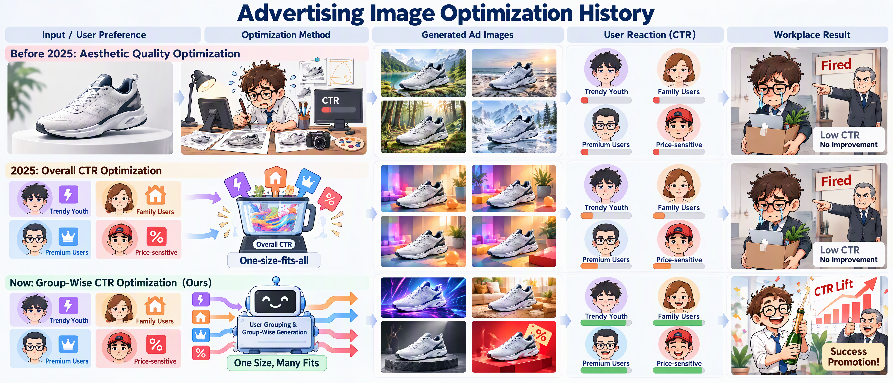

# OSMF: One Size, Many Fits

**[CIKM 2026]** Official PyTorch implementation of
**"[One Size, Many Fits: Aligning Diverse Group-Wise Click Preferences in Large-Scale Advertising Image Generation](https://dl.acm.org/doi/10.1145/3799682.3840680)"**



OSMF is a unified framework that aligns diverse group-wise click preferences in large-scale advertising image generation. It combines **product-aware adaptive grouping**, **preference-conditioned image generation** with a Group-aware Multimodal Large Language Model (**G-MLLM**), and **Group-DPO** for group-wise preference alignment, achieving state-of-the-art performance in both offline and online settings.

---

## 1. Environment

The training environment is built on CUDA 11.8 with PyTorch 2.0.1.

Create a Python environment (Python 3.8/3.9, CUDA 11.8) and install dependencies:

```bash
# PyTorch 2.0.1 + CUDA 11.8
pip install torch==2.0.1 torchvision==0.15.2

# Remaining dependencies
pip install -r requirements.txt
```

> **Note on OpenCV:** Use `opencv-python-headless` instead of `opencv-python` to avoid GUI/`libGL` issues in headless servers:
> ```bash
> pip uninstall opencv-python opencv-python-headless -y
> pip install opencv-python-headless
> ```

---

## 2. Training

### Step 1 — Configure paths and parameters

Edit the two training scripts and fill in the paths to each **Reward model** and the **G-MLLM**, and set your training hyper-parameters:

- [src/shell/train_pm_rm/train_mdpo_reward_forloop.sh](src/shell/train_pm_rm/train_mdpo_reward_forloop.sh) — outer loop controller (number of epochs, `train_id`, overwrite behavior).
- [src/shell/train_pm_rm/train_mdpo_reward.sh](src/shell/train_pm_rm/train_mdpo_reward.sh) — per-epoch pipeline. Set the following variables:

  | Variable | Description |
  |---|---|
  | `project_path` | Root path of your project / output directory. |
  | `reward_model_path` | Path to the Reward model. |
  | `train_data_path` | Path to the training data. |
  | `ref_model_name_or_path` | Path to the pretrained G-MLLM (reference model). |
  | `MODEL_VERSION` | Backbone version (default `v1.6-vicuna-7b`). |

### Step 2 — Launch training

Run the for-loop entry script:

```bash
bash src/shell/train_pm_rm/train_mdpo_reward_forloop.sh
```

Each epoch runs the full Group-DPO pipeline end-to-end:

1. **Prompt generation** — the G-MLLM generates tailored prompts per group.
2. **Background image generation** — advertising images are synthesized.
3. **Reward scoring** — the Reward model scores the generated images.
4. **Group-DPO optimization** — the G-MLLM is fine-tuned with the positive/negative preference pairs, then the LoRA weights are merged for the next epoch.

A completed epoch is marked with a `_SUCCESS` file; the loop automatically resumes from the last successful epoch and retries abnormal epochs.

---

## 3. Data & Pretrained Weights

The **Grouped Advertising Image Preference Dataset (GAIP)** and the pretrained weights are currently going through the company's internal open-source release process and **will be uploaded soon**. Stay tuned.

---

## 4. Citation

If you find this work useful, please cite:

```bibtex
@inproceedings{10.1145/3799682.3840680,
  author    = {Lu, Shuo and Wang, Haohan and Feng, Wei and Wang, Weizhen and Zhang, Shen and Cao, Ke and Fan, Jiahao and Lv, Jingjing and Peng, Changping and Law, Ching and Zhan, Bing and Xu, Yuan and Yao, Huizai and Yu, Yongcan and Si, Chenyang and Liang, Jian},
  title     = {One Size, Many Fits: Aligning Diverse Group-Wise Click Preferences in Large-Scale Advertising Image Generation},
  year      = {2026},
  isbn      = {9798400725395},
  publisher = {Association for Computing Machinery},
  address   = {New York, NY, USA},
  url       = {https://doi.org/10.1145/3799682.3840680},
  doi       = {10.1145/3799682.3840680},
  booktitle = {Proceedings of the 35th ACM International Conference on Information and Knowledge Management},
  pages     = {3397--3408},
  numpages  = {12},
  keywords  = {advertising image generation, online advertising, group-wise reinforcement learning from human feedback},
  location  = {Rome, Italy},
  series    = {CIKM '26}
}
```

---

## 5. Contact

If you have any questions, feel free to reach out at [wang-hh20@tsinghua.org.cn](mailto:wang-hh20@tsinghua.org.cn).

